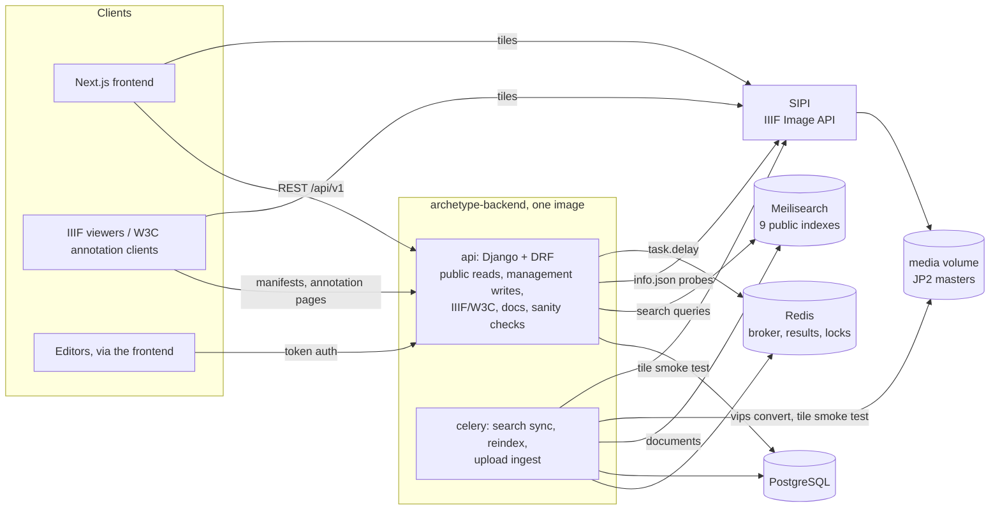
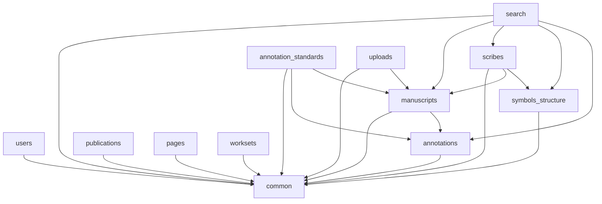
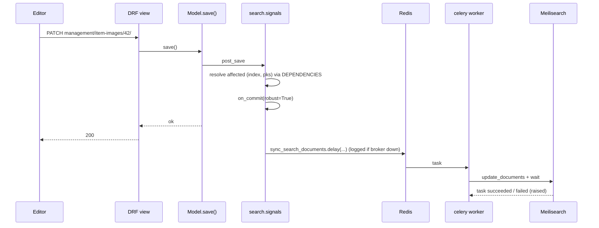
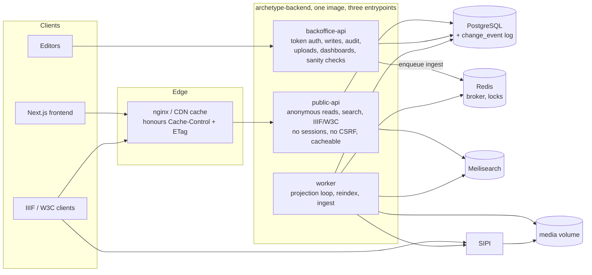
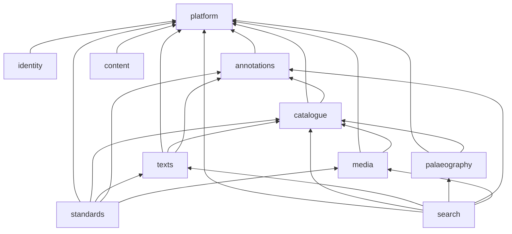
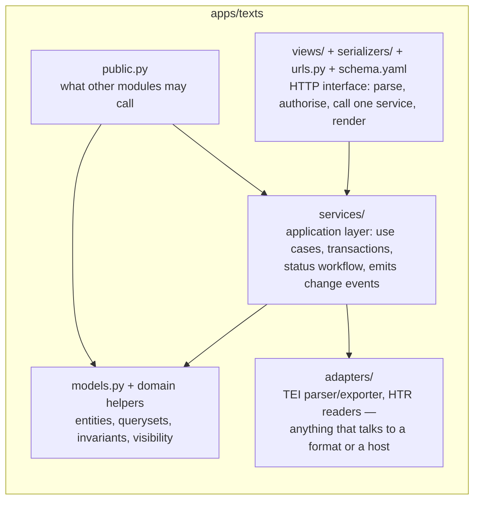
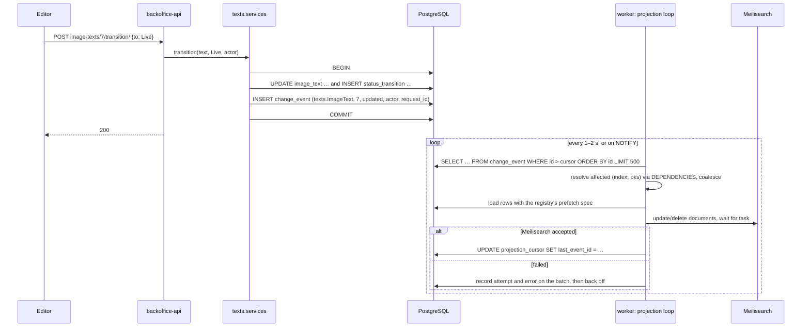
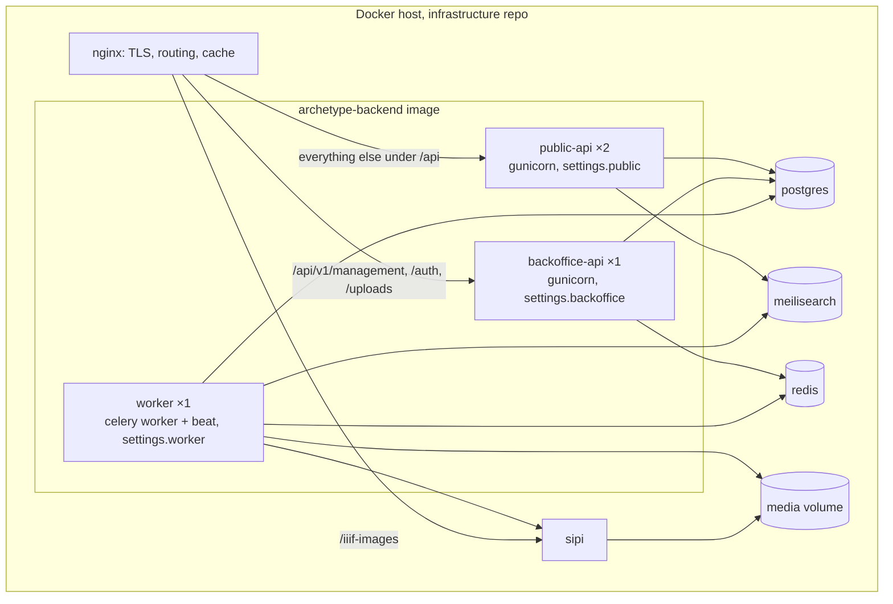

# Architecture: assessment and proposal

Is one Django monolith still the right shape for this backend, and if so,
what should change inside it? This document answers that question with the
codebase as it is after the consolidation pass (`refactor-roadmap.md`), and
proposes a target architecture with a migration path. It is a design
document, not a task list: the tasks fall out of section 6.

Facts used below were measured on the current tree: 12 Django apps, 42
models, 152 routed operations (95 under `management/`, the rest public),
~15.9k non-test and ~15.1k test lines, 1,049 tests, one container image run
as two processes (`api`, `celery`) next to PostgreSQL, Redis, Meilisearch
and SIPI, and a Next.js frontend in another repository.

---

## 1. The system today

### 1.1 Context



### 1.2 Internal structure

The 12 apps and the import edges the boundary checker allows:



`manuscripts` is the hub: 14 of the 42 models, 47 of the 152 routes, the
TEI and HTR services, the IIIF URL helpers and the text status workflow.
`common` is the shared kernel: soft delete, the `EditEvent` audit log,
`Date`/`Place`, site settings, branding, pagination, exports, view bases.

### 1.3 How a write reaches the read models

Every indexed model has `post_save`/`post_delete` receivers registered from
`apps/search/dependencies.py` (plus hand-written ones for `Graph`,
`GraphComponent` and `ItemImage`). They resolve which index documents the
row affects and enqueue a Celery task from `transaction.on_commit`.



The IIIF Presentation / W3C layer (`annotation_standards`) is computed on
every request from the ORM plus an `info.json` probe to SIPI per image
(memoised per process). The public REST API is likewise computed per
request; nothing sets `Cache-Control` or `ETag`.

### 1.4 What works and should be kept

- **The app layout with an enforced dependency graph.** It is the reason
  the consolidation pass was possible in weeks rather than months.
- **The search registry + declarative dependency map + atomic
  build-and-swap reindex.** Data-driven, tested for drift and query counts.
- **Serializer + service per action; views are thin.** Now a house rule in
  CONTRIBUTING with a checker behind it.
- **Soft delete + audit log as shared-kernel primitives.**
- **The ingest ordering invariant** ("no `ItemImage` row before a tile has
  rendered").
- **The test suite**: ~1:1 test-to-code ratio, offline tests for every
  external dependency (FakeBackend, stubbed SIPI).
- **One image, two processes.** Operationally cheap; the infrastructure
  repo is small.

### 1.5 What the structure gets wrong

These are structural, not cosmetic, and none of them are fixed by more
cleanup of the kind already done.

**A. Search sync has no durable record of what changed.** The receivers
are fail-safe now (a broker outage is logged instead of failing the write),
but *fail-safe means lossy*: a change that could not be enqueued, or whose
task failed after retries, is gone until the next full reindex. There is no
ordering between tasks for the same document (two quick edits can apply
out of order), no replay, and the only drift signal is a document count.
The fan-out resolution also runs inside the request, and request-scoped
coalescing state lives in a thread-local inside model signals.

**B. Public visibility is a convention, not a module.** The rule "anonymous
users see Live/Reviewed texts, no editorial graphs, published description
areas only" is implemented in `ImageTextQuerySet.visible_to`,
`GraphQuerySet.visible_to`, `MsDescArea.is_published` checks in three
places, `search/registry.py::_PUBLIC_TEXT_STATUSES` (a copy of the queryset
rule), `annotation_standards/views.py` (re-applied per endpoint) and the
TEI exporter. They agree today because the tests say so. There is no
single place to read the policy, and the search index — which is public
and cannot filter per user — depends on the copy.

**C. One process serves three audiences with one policy.** Public anonymous
reads (cacheable, should survive a database hiccup with stale data),
authenticated back-office writes (audit, CSRF, throttles per user) and
standards endpoints for third-party viewers (CORS wildcard, preflight
middleware, long cache) share one settings module, one middleware stack,
one throttle configuration and one URL tree. The IIIF CORS middleware runs
on every management request; the management auth/audit machinery is loaded
for every manifest fetch. Scaling or hardening one audience means touching
all three.

**D. Modules expose their internals.** The boundary checker is import-level:
it says `scribes` may import `manuscripts`, not *what*. Any app may reach
into another's querysets, signals or service internals, and `scribes`
walks `hand.graph_set` without any import at all. There is no notion of a
module's public surface.

**E. Infrastructure leaks into the domain.** `ItemImage.image` is a
`djiiif.IIIFField` (URL building inside the model), image dimensions are
fetched from SIPI at request time instead of being stored at ingest (which
already renders a tile), the Redis lock cache is reached from a search
service, and serializers and document builders read `image.iiif.info` /
`image.iiif.identifier` straight off the field (six call sites across four
apps). Swapping SIPI or adding a second image store touches models,
serializers, builders and services.

**F. `manuscripts` is two domains.** Catalogue structure (repositories,
historical items, parts, images, dates, descriptions) and *texts*
(`ImageText`, `MsDescArea`, `StatusTransition`, TEI, HTR, the text
dashboard) live in one app because they were built together. The text side
is the larger and faster-moving half and has its own workflow, its own
serialisation format and its own external inputs (HTR).

---

## 2. Is a monolith still right?

Yes. The alternatives were considered and rejected on the merits, not by
default.

| Option | What it would mean | Verdict |
|---|---|---|
| **Keep as is** (continue hygiene passes) | Nothing structural; fix A–F piecemeal as they bite. | Cheapest short term, but A and C are not fixable piecemeal: a replayable change log and per-audience entrypoints are shapes, not patches. |
| **Microservices** (catalogue, texts, search, media as separate deployables) | Separate repos/images, HTTP or message contracts between them, distributed auth, per-service databases or a shared one. | Rejected. The corpus is ~900 texts / 25k graphs; the team is small; every domain object is joined to every other in the read models (a `texts` document carries hand, scribe, allograph, shelfmark, repository and IIIF fields). Splitting the write model would turn today's in-process joins into N+1 network calls or a replicated read store — the thing the search index already is. The operational cost (four pipelines, four sets of secrets, cross-service tracing) would land on the same two or three people who maintain the content. |
| **Two services: "core" + "search"** (the one seam that already exists) | Move `apps/search` into its own deployable consuming a change feed. | Rejected for now, but the proposal below makes it possible later at zero extra cost: once search consumes an outbox rather than signals, it no longer needs to be in-process. Until the team needs to scale or deploy search independently there is no reason to pay the contract-versioning tax. |
| **Modular monolith** (this proposal) | One repo, one image, explicit modules with public interfaces, a change log that feeds projections, and separate *entrypoints* (not services) for public reads, back-office writes and workers. | Adopted. It fixes A–F, keeps the deployment footprint at one image, and leaves the door open to extracting `search` or `media` if that ever becomes worth it. |

The deciding arguments: the data is small and deeply joined; the team is
small; the pain points are about *boundaries and flows inside* the
process, not about scaling or independent deployment.

---

## 3. Target architecture

### 3.1 Context



Same image, same code; `public-api` and `backoffice-api` differ by
settings module and URL root. Nothing prevents running both behind one
hostname at first (nginx routes `/api/v1/management/*`, `/api/v1/auth/*`,
`/api/v1/uploads/*` to one upstream and everything else to the other).

### 3.2 Modules

Django apps remain the unit of persistence and migrations; *modules* are
the unit of design. One module maps to one or two apps. The names below
are what the documentation, the boundary checker and the directory layout
use; existing app labels and table names do not change (see 6.3 for the
one optional split).

| Module | Apps | Owns | Public surface (`apps/<app>/public.py`) |
|---|---|---|---|
| **platform** | `common` | soft delete, `EditEvent` + change log, `Date`/`Place`, site settings, branding, pagination, exports, view bases, visibility policy | everything it exports today; it is the shared kernel |
| **identity** | `users`, `worksets` | accounts, tokens, user-owned worksets | `UserSummary`, `current_user()` |
| **catalogue** | `manuscripts` (structure half) | repositories, current/historical items, parts, images, dates, descriptions, catalogue numbers, formats | `ItemPart`, `ItemImage` read models; `image_identifier()`; `item_images_for_part()` |
| **texts** | `manuscripts` (text half; optionally its own app later) | `ImageText`, `MsDescArea`, `StatusTransition`, TEI document model, HTR import, text dashboard | `visible_texts(user)`, `tei_document(text)`, `transition(text, to, actor)` |
| **palaeography** | `symbols_structure`, `scribes` | characters, allographs, components, features, positions, scripts, scribes, hands | `Hand`, `Allograph` read models; `hands_for_part()` |
| **annotations** | `annotations` | graphs (regions on images), graph components | `visible_graphs(user)`, `graphs_for_image()` |
| **standards** | `annotation_standards` | IIIF Presentation 3 manifests, W3C annotation pages, content search | HTTP only |
| **search** | `search` | registry, document builders, Meilisearch adapters, the projection consumer | HTTP only + `reindex()` for the CLI |
| **content** | `publications`, `pages` | CMS: publications, events, carousel, partners, comments, pages, menus | HTTP only |
| **media** | `uploads` + `manuscripts/services/{iiif,media}.py` + the ingest pipeline | chunked uploads, vips conversion, SIPI adapter, file deletion, dimensions | `IIIFImageServer` adapter, `ingest(session)` |

Dependency rules, enforced by the existing checker extended to module
granularity:



Two rules beyond "which module may import which":

1. **Cross-module imports go through `public.py`** (models may be imported
   for FK declarations and read-only querysets; `services/`, `serializers/`,
   `views/`, `signals.py`, `tasks.py` and adapters are module-private).
   The checker already forbids importing `views`; this extends the list.
2. **Projections and standards are read-only consumers.** `search` and
   `standards` import from everything they present and nothing imports
   from them. That is already true; it becomes a stated property.

### 3.3 Inside a module



This is the layout AGENTS.md already prescribes, with two additions:
`adapters/` for infrastructure (today `services/tei`, `services/htr`,
`services/iiif.py`, `search/meilisearch/`) and `public.py` as the only
cross-module import target. Models stay Django models — no separate
"domain entity" classes; the ORM *is* the domain layer in a Django
codebase of this size, and pretending otherwise doubles the code.

### 3.4 Write path: change log + projections

Replace signal-triggered Celery tasks with a **transactional outbox**:
every write to a model that feeds a read model appends a row to a change
log *in the same transaction*; a worker loop consumes the log in order and
updates the projections (Meilisearch today; a manifest cache tomorrow).



**Table design.** `EditEvent` already records actor, action, target type
and id for audited models; the change log generalises it rather than
adding a second table.

```
common_editevent (existing, extended)
  id             bigserial PK              -- global order
  created        timestamptz, indexed
  actor_id       FK users, nullable
  action         created|updated|deleted|status_changed|trashed|restored|commented
  target_type    "manuscripts.ImageText"   -- app_label.Model, not the current short slug
  target_id      bigint
  summary, payload                          -- unchanged (editor-facing)
  request_id     varchar(36)               -- from RequestIDMiddleware; groups one request's events
  projection_data jsonb, nullable          -- pre-change values a projection needs
                                           -- (e.g. the item_part an image left)

common_projectioncursor (new)
  name           varchar(64) PK            -- "search", later "manifests"
  last_event_id  bigint
  updated        timestamptz
  last_error     text, nullable
  failed_since   timestamptz, nullable
```

Properties this buys, against today's signals:

| Property | Signals + `task.delay` | Change log + projection loop |
|---|---|---|
| Durability | lost if broker down or task fails after retries | committed with the data; cannot be lost |
| Ordering | none (tasks race) | global `id` order; one consumer per projection |
| Replay | full reindex only | reset the cursor to any event id; `replay --since` |
| Fan-out cost | in the request (`DEPENDENCIES` resolution in `post_save`) | in the worker, batched and coalesced over 500 events |
| Coalescing | thread-local per request | natural: one batch, `set()` of `(index, pk)` |
| Drift signal | document counts | cursor lag in events and seconds, failed batches, per-projection |
| Kill switch | `SEARCH_AUTO_REINDEX` stops *enqueueing* (changes lost) | pause the consumer; events accumulate and are applied on resume |
| Audit | separate `EditEvent` on three models | every indexed write is audited for free |

What does **not** change: the registry, the builders, `DEPENDENCIES`, the
Meilisearch adapters, the full reindex, and the settings-apply step all
stay. The projection loop is a new consumer of the same resolution code
the signals call today (`sync_dependent_documents` minus the `on_commit`).

Implementation notes:

- Appending to the log happens in the application layer (services), not
  in `post_save`, so that a bulk import can append one event per row
  without a signal per row, and so that `QuerySet.update()` paths (which
  bypass signals today and silently skip sync) are covered where they
  matter. A thin `post_save` fallback can stay during the transition for
  models still written through the ORM directly.
- The loop is a Celery beat task (`project_changes`, every 2 s, lock per
  projection) — no new process type. `LISTEN/NOTIFY` can shorten the
  latency later without changing the design.
- A batch that Meilisearch rejects is retried with backoff; after N
  attempts the cursor stops and the dashboard shows `failed_since`. This
  replaces "silently dropped" with "visibly stuck", which is the right
  failure mode for a curated corpus.
- `SEARCH_AUTO_REINDEX` becomes "pause the search projection" and is
  stored in `AppSettings`, not the environment, because pausing is an
  operational act, not a deployment property.

### 3.5 Visibility policy as one module

`apps/common/visibility.py` (platform) becomes the only place that knows
what anonymous, authenticated and staff users may see:

```python
@dataclass(frozen=True)
class Audience:
    anonymous: bool
    staff: bool

    @classmethod
    def of(cls, user) -> Audience: ...


PUBLIC = Audience(anonymous=True, staff=False)


def text_status_filter(audience: Audience) -> Q: ...
def graph_type_filter(audience: Audience) -> Q: ...
def published_areas_only(audience: Audience) -> bool: ...
```

`ImageTextQuerySet.visible_to`, `GraphQuerySet.visible_to`, the search
registry's `queryset_filter`, the TEI exporter's `published_only` and the
standards views all call into it. The search index is built for `PUBLIC`
by construction, and a test asserts that the public REST API, the index
and the manifests agree on the visible set for a fixture corpus — the
property that is currently implied by four independent tests.

### 3.6 Entrypoints

One codebase, three ways to start it. The split is in `config/`:

```
config/
  settings/
    base.py          # everything shared (apps, DB, logging, IIIF, Meili)
    public.py        # base + no sessions/CSRF/admin middleware, anon throttle,
                     #   CORS wildcard for standards routes, Cache-Control defaults
    backoffice.py    # base + token auth, CSRF for cookie clients, audit actor,
                     #   user throttle, uploads limits
    worker.py        # base + Celery; no REST settings
    test.py
  urls/
    public.py        # /api/v1/ read routes, /search/, /iiif/, /annotations-w3c/, /schema/, /docs/
    backoffice.py    # /api/v1/auth/, /api/v1/management/…, /api/v1/uploads/, sanity checks
  asgi.py / wsgi.py  # pick by DJANGO_SETTINGS_MODULE
  celery.py
```

Apps keep one `urls.py` each but split it into two `urlpatterns` lists
(`public_urlpatterns`, `management_urlpatterns`); today's mixed
`path("api/v1/", include("apps.scribes.urls"))` pattern becomes explicit.
The route-documentation test runs against the union and additionally
asserts that no write method is routed from `urls/public.py`.

Benefits, concretely:

- The public process has no `SessionMiddleware`, no CSRF, no
  `AuthenticationMiddleware` beyond DRF's token check (needed only to
  widen visibility for logged-in readers), and returns
  `Cache-Control: public, max-age=…` + `ETag` on catalogue, text and
  manifest reads. The CDN/nginx can then serve most anonymous traffic and
  absorb a database restart.
- The back-office process can be restarted, rate-limited, or put behind
  an IP allow-list without touching public traffic.
- Standards endpoints get their CORS/preflight handling in one place
  (`public.py` middleware) instead of a middleware that runs for every
  request of every audience.
- The worker never imports DRF.

### 3.7 Media: store what ingest already knows

Ingest renders a tile before creating the `ItemImage`; at that moment the
width and height are known. Store them (`ItemImage.width`, `.height`,
`.iiif_identifier`) and drop the request-time `info.json` probe,
`IIIF_INTERNAL_HOST` and the per-process `lru_cache`. `IIIFField` is
replaced by a plain `FileField` plus `media.public.iiif_url(identifier,
profile)` — URL building moves out of the model into the one adapter that
knows the image server. A one-off command backfills dimensions for
existing rows; the search documents and manifests then need no SIPI at
all on the read path.

### 3.8 Deployment



Still one image and one compose project. The change in the infrastructure
repo is two extra service stanzas and two nginx `location` blocks; the
post-deploy step becomes `migrate && setup_search_indexes`.

---

## 4. Directory layout (target)

```
apps/
  common/                     platform
    models.py                 SoftDeleteModel, EditEvent, ProjectionCursor, Date, Place, AppSettings, SiteLabel
    visibility.py             Audience + policy functions (3.5)
    changelog.py              record_change(instance, action, actor, request_id, projection_data)
    audit.py                  actor context (unchanged)
    services/                 branding, site_features, sanity_checks
    viewsets.py, filters.py, pagination.py, exports.py, exceptions.py, task_status.py
  users/, worksets/           identity
  manuscripts/                catalogue (+ texts until 6.3)
    models.py
    public.py
    services/                 historical_items, images, image_picker, image_texts, text_monitoring
    adapters/                 tei/, htr/  (moved from services/)
    serializers/, views/, filters.py, urls.py, schema.yaml
  symbols_structure/, scribes/   palaeography
  annotations/                annotations
  annotation_standards/       standards (read-only consumer)
  search/                     search (read-only consumer)
    registry.py, dependencies.py, documents/, types.py, contracts.py
    projection.py             the change-log consumer (replaces signals.py)
    meilisearch/              adapter (unchanged)
    services.py, admin_service.py, views*.py, exports.py, quality.py
  publications/, pages/       content
  uploads/                    media
    services.py, ingest.py
    adapters/sipi.py          IIIFImageServer: iiif_url(), verify_tile(), dimensions()
config/
  settings/{base,public,backoffice,worker,test}.py
  urls/{public,backoffice}.py
scripts/check_architecture_boundaries.py   module map + public.py rule
docs/
  architecture.md             this document's section 3, maintained
  search-architecture.md, search-operations.md
```

---

## 5. What this does *not* propose

- **No new domain-entity layer, repositories or CQRS framework.** The ORM
  stays the domain model; services stay plain functions; serializers stay
  DRF. The codebase is 16k lines — abstraction that doubles it would be a
  regression.
- **No message broker beyond Redis/Celery.** The change log is a table;
  the consumer is a beat task.
- **No GraphQL, no API gateway, no BFF.** The frontend already consumes
  the REST contract; the entrypoint split is invisible to it.
- **No database-per-module.** One PostgreSQL, one migration history,
  cross-module FKs allowed (that is what a modular monolith is for).
- **No renaming of existing app labels or tables** except the optional
  `texts` split in 6.3, which keeps `db_table`.

---

## 6. Migration path

Each step is shippable on its own and leaves the system better than it
found it; none requires a frontend change except where marked.

### 6.1 Change log + projection loop (replaces search signals) — ~1 week

1. Extend `EditEvent` (`target_type` to `app_label.Model`, `request_id`,
   `projection_data`); add `ProjectionCursor`. Register every model in
   `DEPENDENCIES` for audit (today: `Graph`, `ImageText`, `ItemImage` and
   the two settings models).
2. `apps/search/projection.py`: consume events from the cursor, resolve
   with `DEPENDENCIES`, batch-write, advance. Reuse
   `sync_dependent_documents`' resolution; reuse the writer.
3. Run both paths for one release (signals still enqueue; projection also
   applies) and compare with the drift test on staging.
4. Delete `signals.py`'s enqueueing, `sync_search_documents` /
   `delete_search_documents` tasks, the thread-local coalescing, and
   `SEARCH_AUTO_REINDEX` (becomes an `AppSettings` pause flag).
5. Dashboard: cursor lag and `failed_since` on the existing search status
   endpoint; `replay_changes --since <event-id|timestamp>` command.

Risk: low — additive until step 4, and the full reindex remains the
recovery path throughout.

### 6.2 Visibility module — ~2 days

Introduce `common/visibility.py`; route the five call sites through it;
add the agreement test (REST vs index vs manifest on a fixture corpus).
Pure refactor; no contract change.

### 6.3 Module surfaces — ~3 days, then optional split

1. Add `public.py` to each app; move cross-module callers onto it; extend
   the checker to forbid cross-module imports of `services`, `serializers`,
   `views`, `signals`, `tasks`, `adapters`. `scribes`' `hand.graph_set`
   walk becomes `annotations.public.graphs_for_hands()`.
2. Rename `services/tei`, `services/htr` → `adapters/`; `search/meilisearch`
   is already an adapter package.
3. Optional, when the text side next grows: move `ImageText`, `MsDescArea`,
   `StatusTransition`, the TEI/HTR adapters, `services/image_texts.py`,
   `services/text_monitoring.py` and `views/image_texts.py` into
   `apps/texts` with `Meta.db_table` pinned and a `SeparateDatabaseAndState`
   migration. URL paths stay under `/manuscripts/`. This is a day of
   mechanical work and a risk only to imports, which the checker and the
   suite catch.

### 6.4 Media: dimensions at ingest — ~2 days

Add `width`/`height` to `ItemImage`, set them in ingest's register step,
backfill command, switch `resolve_dimensions_for` to read the columns and
probe only when null; remove the probe once backfilled. Replace
`IIIFField` with `FileField` + `media.public.iiif_url()`; the serializer
output is byte-identical, so no frontend change.

### 6.5 Entrypoints — ~3 days backend + infrastructure change

1. Split `config/settings.py` into `settings/{base,public,backoffice,
   worker}.py`; split each app's `urls.py` into public and management
   lists; add `config/urls/{public,backoffice}.py`. The existing
   `config/urls.py` stays as the union for local development and tests.
2. Add `Cache-Control`/`ETag` to public list/detail views via one mixin
   (last-modified from `modified` columns where present, else short
   max-age).
3. Infrastructure repo: second gunicorn service, nginx routing, health
   checks per entrypoint.

Risk: medium, mostly operational. Feature-flag by running both processes
from `settings.backoffice` first (identical behaviour), then switching the
public upstream.

### 6.6 Afterwards

With 6.1 and 6.5 in place, extracting `search` into its own deployable is
a matter of pointing a second consumer at the change log — if it is ever
needed. Nothing in this proposal bets on it.

---

## 7. Summary

| Problem (1.5) | Fix (3.x) | Step |
|---|---|---|
| A. Lossy, unordered, unreplayable search sync | Change log + projection cursor | 6.1 |
| B. Visibility policy in six places | `common/visibility.py` + agreement test | 6.2 |
| C. Three audiences, one process policy | `public-api` / `backoffice-api` / `worker` entrypoints | 6.5 |
| D. Modules expose internals | `public.py` per app, checker extended | 6.3 |
| E. Infrastructure in the domain | `adapters/`, dimensions stored at ingest, `IIIFField` gone | 6.3, 6.4 |
| F. `manuscripts` is two domains | optional `texts` app with pinned tables | 6.3 |

Total: roughly three weeks of backend work spread over several releases,
one small infrastructure change, no frontend change, one image, and a
system whose read models can be rebuilt from a log instead of from hope.
